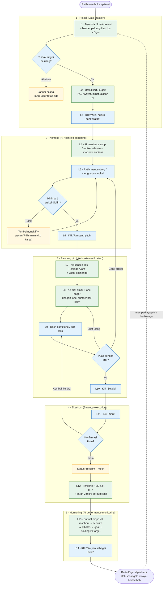
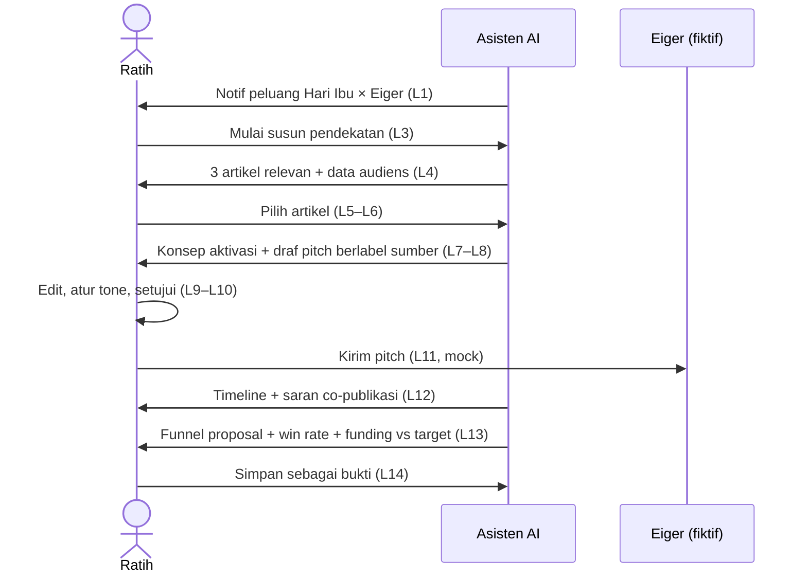

# User Flow — Asisten Funding Ratih

> Skenario: Ratih mengajak Eiger bekerja sama untuk aktivasi Hari Ibu (22 Desember).
> Nomor langkah (L1–L14) sama dengan PRD dan panduan user testing.
> Hijau = kerja AI ("AI menyarankan") · Biru = keputusan Ratih.

## Alur utama

## Ringkas: siapa melakukan apa

## Titik kritis untuk desain & testing
- **L5, L9, L10:** di sini kendali Ratih atas AI harus paling terasa.
- **L8:** label sumber adalah kunci kredibilitas. Amati apakah peserta testing melihatnya tanpa diminta.
